# Introduction

The study of Rome sits as a well worn topic in the humanities going all the way back to the Renessaince and argueably down to the fall of the empire itself.  Warfare was a fundamental component of the political, territorial, and administrative development of the Roman world and has take up a large component of the aforementioned study. Military engagements occurred across a geographically extensive territory, ranging from the Italian peninsula and western Mediterranean to the frontiers of northern Europe, North Africa, and the eastern Mediterranean. Although the historical circumstances of individual battles have received considerable scholarly attention, their collective geographic distribution has been understudied. Utilizing geographical statistical modeling offers an avenue to build upon past strategic history on the Roman Empire.

Few historians would claim that battle locations were distributed randomly across the landscape on a qualitative basis, but such a claim has not yet been tested on a quantitative basis. Similarly, military engagements may have been influenced by the location of established settlements, the boundaries of Roman territorial control, and the presence of specialized infrastructure such as forts. Internal conflicts may exhibit different geographic characteristics from conflicts involving external opponents.

By combining georeferenced battle records with reconstructed historical boundaries and settlement data, it is possible to evaluate whether observed battle locations exhibit spatial patterns consistent with particular geographic features. This study investigates the spatial distribution of Roman battles through a series of spatial statistical tests and Monte Carlo simulations. Rather than assuming that a single geographic factor explains the location of military engagements, the analysis compares several alternative spatial models.

The primary objectives are:

1. Determine whether Roman battle locations exhibit significant spatial clustering relative to spatial randomness.
2. Evaluate whether the distribution of battles is associated with the historical distribution of settlements.
3. Investigate whether battles occurred disproportionately close to the territorial boundaries of Roman control.
4. Examine whether external conflicts and civil conflicts exhibit different spatial relationships with military and civic infrastructure.

By examining these relationships together, this study seeks to better understand the geographic characteristics of Roman warfare and the relationship between military activity and the historical Roman landscape.

# Literature Review

## The Grand Strategy of the Roman Empire

In the seminal work *The Grand Strategy of the Roman Empire*, Luttwak examines how Roman military organization and defensive strategy evolved through time in response to the changing demands of the empire [@luttwak2016grand]. His work emphasizes the relationship between military deployment, frontier defense, fortifications, and the broader territorial organization of Roman power. Luttwak's interpretation of Roman strategy has been influential and it provides  a qualitative backdrop for the work in the paper that seeks to consider how military activity was associated with the geography of Roman control.  

## GIS Analysis of the Roman Conquest of Dacia

More recent archaeological research has demonstrated the value of GIS-based spatial analysis for investigating these relationships at a geographic scale. Oltean and Fonte use GIS, remote sensing, and spatial modeling to examine the relationships between Roman military bases, Dacian strongholds, and the surrounding landscape during the Roman conquest of Dacia [@oltean2021gis]. Their analysis considers how terrain, visibility, and potential movement routes influenced the strategic positioning of military installations. Their research shows how spatial analysis is a valid tool to evaluate historical interpretations of Roman military activity and reveal relationships between military infrastructure and the surrounding landscape. While their research focuses on a particular campaign and geographic region compared to this papers more broad inquiry, it provides a direct precedent for using GIS to investigate the spatial characteristics of Roman warfare.

## Modelling Spatial Heterogeneity in Archaeological Landscapes

The application of spatial analysis to archaeological distributions also provides a broader foundation for this research. Bevan and Conolly examine spatial heterogeneity in archaeological artifact distributions, demonstrating that patterns of material remains can vary across landscapes and that relationships between archaeological distributions and environmental characteristics may not be geographically uniform [@bevan2009modelling]. Their work highlights the importance of accounting for underlying spatial structure when interpreting the distribution of archaeological evidence. This is relevant to the present study because the geographic distribution of documented settlements provides an important baseline against which the distribution of battle locations can be evaluated. Rather than assuming that battles occurred independently of existing settlement patterns, the analysis considers whether the observed distribution can be explained by the broader geography of documented human activity.

## Statistical Analysis of Archaeological Settlement Patterns

Similarly, Weber, Stoyan, and Myllymäki apply spatial point-pattern analysis to investigate relationships between archaeological settlement distributions across multiple historical periods [@weber2016statistical]. Their research demonstrates how the spatial association, continuity, and separation of archaeological site distributions can be evaluated quantitatively rather than relying exclusively on visual interpretation. Although their study focuses on archaeological settlement patterns rather than military engagements, it illustrates the value of treating archaeological locations as spatial distributions that can be compared and evaluated statistically. This provides a useful parallel for examining whether Roman battle locations exhibit patterns of clustering and geographic association beyond those expected from alternative spatial distributions.

# Data and Study Area

## Roman Battle Locations

The primary dataset consists of georeferenced battle records associated with Roman military history. Battle records were collected using Wikidata @wikidata and subsequently reviewed to determine whether Rome was involved in each engagement. The resulting dataset includes battle identifiers, names, dates, classifications, and associated geographic locations.

Each battle is assigned to one of two classifications:

- **External:** Conflicts involving Rome and external opponents.
- **Civil Conflict:** Conflicts involving internal Roman political or military factions.

Battle locations are represented using geographic coordinates and converted into spatial point geometries for subsequent analysis. Because individual battles may have multiple associated location records, the analysis distinguishes between battle-location records and unique battles. Analyses using multiple location records retain the associated geographic observations, while the later classification-based nearest neighbor analysis constructs one representative point per unique battle.

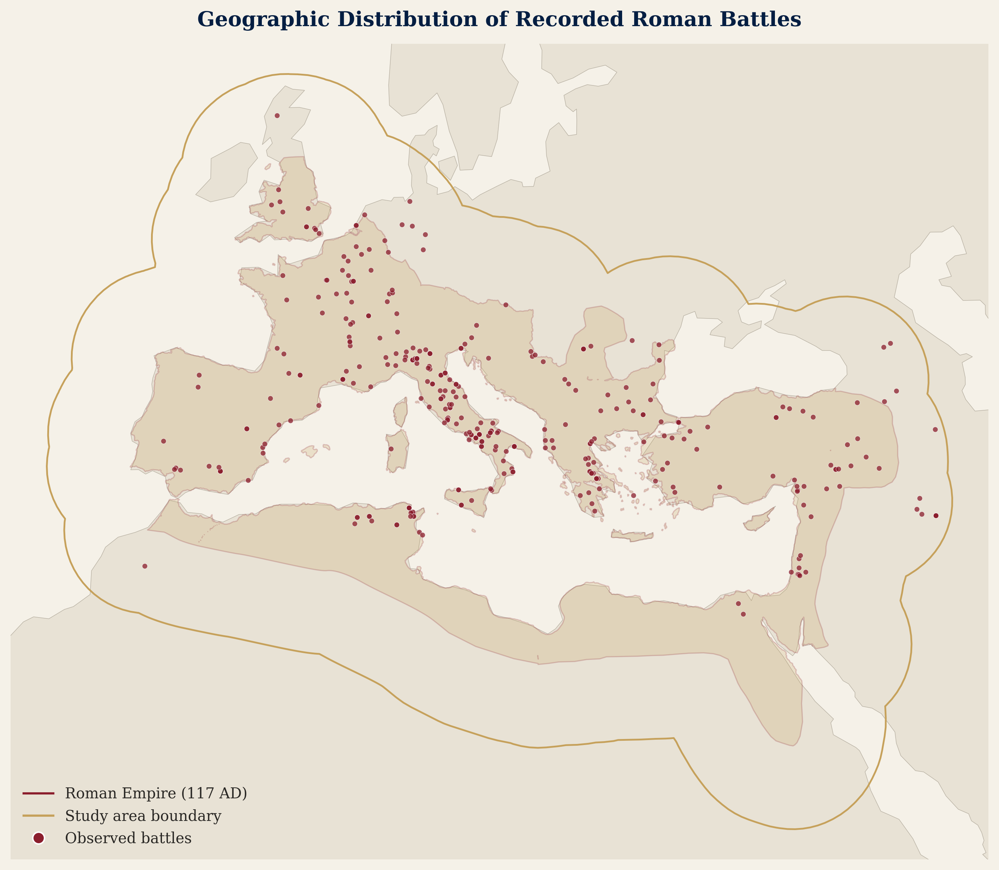{#fig-battle-locations}

## Historical Roman Territorial Boundaries

Historical Roman territorial boundaries were collected to represent the changing geographic extent of Roman control across nine historical periods. Boundary reconstructions were obtained from two online geographic data sources: the *Roman Empire Cultural Shapefiles* ArcGIS Feature Service @arcgis_roman_empire and the *Roman Empire Map* project @roman_empire_map.

The ArcGIS Feature Service provided six historical boundary layers. The available layers were first inspected through the service's metadata to identify relevant historical reconstructions and their associated geographic attributes. The selected layers were downloaded as GeoJSON files using the ArcGIS REST API, with their output coordinate reference system specified as WGS 84 (EPSG:4326).

Three additional Republican period boundary reconstructions were obtained from the Roman Empire Map project's GeoJSON dataset. The source dataset contained multiple historical boundary features, which were filtered by date and by the `part` attribute. Only features representing the complete territorial extent (`part = "whole"`) were retained for the years 264 BC, 133 BC, and 44 BC. These selected boundaries were then converted to EPSG:4326 and saved as individual GeoJSON files.

The resulting collection contains nine historical boundary snapshots:

| Historical snapshot | Year | Data source |
|---|---:|---|
| 264 BC | -264 | Roman Empire Map |
| 133 BC | -133 | Roman Empire Map |
| 60 BC | -60 | ArcGIS Feature Service |
| 44 BC | -44 | Roman Empire Map |
| 14 AD | 14 | ArcGIS Feature Service |
| 69 AD | 69 | ArcGIS Feature Service |
| 117 AD | 117 | ArcGIS Feature Service |
| 200 AD | 200 | ArcGIS Feature Service |
| 314 AD | 314 | ArcGIS Feature Service |

After collection, the boundary files were loaded into GeoPandas for inspection. This included reviewing their feature counts, coordinate reference systems, geometry types, geographic extents, and geometry validity. The individual reconstructions were also mapped separately and overlaid to examine how the geographic extent of Roman territory changed across the selected periods.

These boundary datasets provide historical approximations of Roman territorial extent rather than continuous representations of Roman expansion and contraction. Because the reconstructions are available only for selected historical dates, they serve as temporal reference points for the spatial analysis rather than exact representations of Roman territorial control at every battle date.

## Settlement Data

Settlement information is obtained from the Pleiades Gazetteer @pleiades, a historical geographic resource documenting locations associated with the ancient world. The settlement dataset includes geographic coordinates, feature classifications, and temporal attributes. Two temporal attributes are particularly important:

- `MINDATE`: Earliest associated date.
- `MAXDATE`: Latest associated date.

These attributes are used to construct historical settlement datasets corresponding to the nine Roman territorial snapshots. A settlement is included in a historical period when its recorded date range contains the year of that snapshot. The settlement dataset also includes specialized feature classifications, allowing the analysis to distinguish between general settlements and particular types of infrastructure. These include ports, temples, forts, amphitheaters, and theaters.

## Geographic Study Area

The geographic study area is defined using the Roman territorial boundary reconstruction from 314 AD. The boundary geometry is combined and projected into an coordinate reference system centered approximately on the Mediterranean region. A 500-kilometer buffer is then constructed around the territorial boundary.  This buffer allows for Roman campaigns deep into territory that they did not control, such as campaigns fought agaisnt Parthia or Sassanid Iran in territory that they would never control, but also for earlier periods allow for battles in Spain and North Africa during the punic wars that would at later periods be incorporated into the Roman Empire. Settlement records are restricted to this study area before the primary spatial analyses.

# Methodology

The analysis is organized as a sequence of spatial investigations designed to develop increasingly specific explanations for the geographic distribution of Roman battles. Rather than treating battle locations as an isolated spatial phenomenon, the analysis progressively incorporates historical and geographic context to examine the factors associated with their distribution.

The first stage establishes the degree of spatial clustering among recorded battles. The second examines whether the distribution of settlements provides an explanation for this clustering. The third introduces Roman territorial boundaries to investigate the relationship between military activity and the geographic limits of Roman control. Finally, the analysis considers whether different categories of conflict exhibit distinct relationships with specialized military and civic infrastructure.

## Spatial Data Preparation

The battle dataset contains geographic records associated with individual battles. Records with missing or invalid coordinates are excluded before spatial analysis, and the remaining coordinates are converted into point geometries. Settlement locations are similarly restricted to valid point geometries within the defined study area.

All spatial datasets are transformed into a common projected coordinate reference system to support distance calculations in meters. The study area is defined using the historical Roman territorial boundary for 314 AD and a 500 km surrounding buffer.

The unit of analysis varies across the investigations. The initial spatial randomness, settlement, and territorial-boundary analyses use battle-location records. The final classification-based infrastructure analysis instead consolidates records belonging to the same battle into a single representative location. For battles with multiple location records, the geometries are combined and their centroid is used as the representative point. This produces a dataset of unique battles for comparing the spatial clustering of external and civil conflicts.

## Monte Carlo Simulation Framework

The primary statistical approach uses Monte Carlo simulations to compare observed battle distributions against alternative spatial models.

For each model, the observed spatial statistic is compared with the empirical distribution generated by its corresponding simulations. The expected statistic is calculated as the mean of the simulated values, while the 2.5th and 97.5th percentiles provide an empirical interval for evaluating the observed result. The observed-to-expected ratio is calculated by dividing the observed statistic by the simulated mean. For distance-based statistics, ratios below 1 indicate that the observed distances are shorter than expected, while ratios above 1 indicate that they are longer.

The direction of the Monte Carlo test depends on the research question. Lower-tail tests are used when evaluating whether observed distances are unusually short, such as in the settlement-feature proximity analysis. Two-sided tests are used for the classification-based infrastructure models, where unusually short and unusually long nearest-neighbor distances are both relevant.

## Spatial Clustering

The initial analysis evaluates whether Roman battle locations exhibit greater spatial clustering than would be expected under spatial randomness (CSR). Mean nearest-neighbor distance is used as the measure of spatial concentration. For each observed battle location, a k-d tree is used to identify the distance to its nearest neighboring battle location. The mean of these distances provides the observed clustering statistic.

The CSR null model generates simulated battle locations by uniformly sampling points within the study area. Each simulation preserves the number of observed battle-location records. The mean nearest-neighbor distance is calculated for each simulated distribution and compared with the observed statistic. Smaller mean distances indicate greater spatial clustering.

## Settlement Geography

The settlement-based model evaluates whether the geographic distribution of documented settlements helps explain the spatial concentration of Roman battles. Because reliable population-density estimates are difficult to establish for the ancient world, documented settlement locations are used as an imperfect proxy for the spatial distribution of human activity.

A Gaussian kernel density estimate (KDE) is fitted to the filtered Pleiades settlement locations using a bandwidth of 50 km. The resulting intensity surface is evaluated across a 20 km sampling grid covering the study area. Grid-cell intensity estimates are normalized into sampling probabilities, with locations near concentrations of documented settlements receiving greater probability of selection.

Monte Carlo simulations generate synthetic battle locations by sampling grid cells according to these probabilities. Each simulation preserves the number of observed battle locations and is used to calculate an expected mean nearest-neighbor distance. This provides a settlement-conditioned baseline for evaluating whether the observed clustering of battles can be explained by the distribution of known settlements.

For the historical boundary analysis, separate settlement intensity surfaces are also constructed for each of the nine historical boundary snapshots. Settlement records are assigned to a snapshot using their Pleiades temporal attributes, retaining locations whose recorded date ranges include the snapshot year.

The settlement-based model is also applied separately to external battles and civil conflicts. These classification-specific simulations preserve the number of observed battle locations in each group and provide separate expected nearest-neighbor distances for comparison with the corresponding observed distributions. The combined results provide a general settlement-based baseline for evaluating the infrastructure-weighted models.

## Territorial Boundaries

The third stage introduces historical territorial boundaries to examine the relationship between Roman military activity and the geographic extent of Roman control. Battle locations are compared with the nearest historical territorial perimeter corresponding to their assigned chronological period. Their observed distances from these boundaries are evaluated against distances generated by settlement-based simulations. This approach examines whether the proximity of battles to territorial boundaries can be explained by the underlying distribution of settlements, or whether battles exhibit an additional concentration near the boundaries of Roman territory.

Territorial boundary association is examined by calculating the shortest distance between each observed battle location and the corresponding historical Roman territorial perimeter.

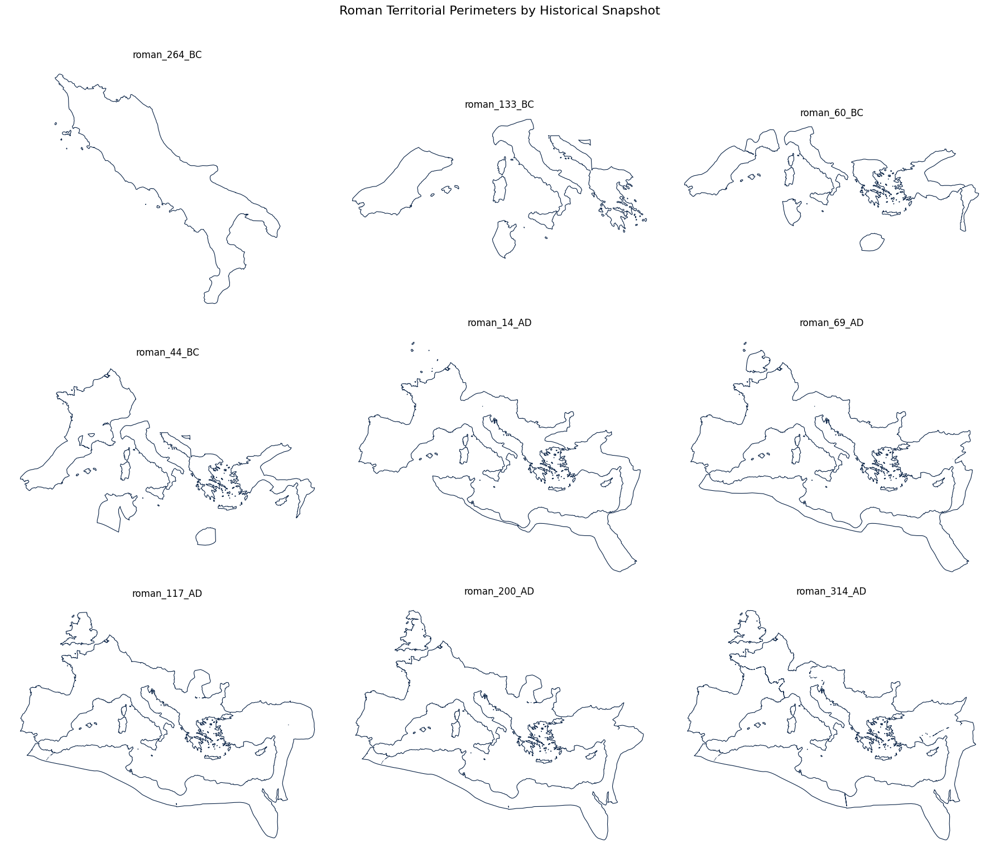{#fig-historicalborderssnapshot}

For each battle, the applicable perimeter is determined using its assigned historical boundary snapshot. Each battle is assigned to the closest available historical boundary snapshot based on its date. The analysis uses nine historical snapshots, ranging from 264 BC to 314 AD. This approach allows each battle to be evaluated against the territorial perimeter that most closely represents its chronological context.  The observed mean distance to the historical perimeter is then compared against simulated distributions. Two alternative approaches are evaluated.

First, the settlement-based model is used to generate simulated battle locations, with their distances to the corresponding historical perimeters establishing the expected boundary distances under a settlement-conditioned null model. A complementary set of simulations uses exponential distance-decay functions to generate spatial distributions increasingly concentrated around territorial boundaries. These boundary-weighted distributions allow different levels of border concentration to be compared with the observed geographic pattern. Specifically, exponential decay is used to construct spatial distributions at varying levels of concentration around the historical perimeters:

$$
w(d) = e^{-d/\lambda}
$$

where:

- $d$ is the distance from a grid cell to the corresponding territorial perimeter.
- $\lambda$ is the distance-decay parameter.

Four decay distances are evaluated:

- 25 kilometers
- 50 kilometers
- 100 kilometers
- 200 kilometers

Smaller decay parameters concentrate simulated locations more strongly near the territorial perimeter.

The observed boundary distances are compared against the resulting simulated distributions to evaluate whether the observed patterns are consistent with different levels of territorial boundary association.

For the classification-based comparison, the border-weighted simulations are also conducted separately for external battles and civil conflicts. Each simulation preserves the observed number of battle-location records within each classification and historical period. The period-specific observed and simulated mean distances are then pooled across the full historical dataset using the number of battle-location records in each period as weights. This allows the overall results to account for differences in the number of recorded battles across historical periods while maintaining separate estimates for each conflict classification.

## Military and Civic Infrastructure

The final stage examines whether the geographic distribution of battles is associated with specialized settlement infrastructure and whether these relationships differ by conflict classification. The analysis considers ports, temples, forts, and entertainment facilities, with amphitheatres and theatres grouped into that single category. Two separate approaches are used. The first evaluates whether battles are unusually close to particular infrastructure features relative to the broader settlement distribution. The second examines whether infrastructure-weighted spatial distributions can reproduce the observed clustering of external battles and civil conflicts.

The selection of these infrastructure categories is informed by the preceding feature-proximity analysis, which identifies differences in the relationships between conflict classifications and specialized settlement features. Forts are used to represent military infrastructure relevant to external battles, while entertainment facilities provide the corresponding civic infrastructure category for civil conflicts.

### Proximity to Specialized Settlement Features

The first analysis evaluates the proximity of battle locations to four categories of settlement infrastructure: ports, temples, forts, and entertainment facilities. For each category, the nearest-feature distance is calculated for every observed battle location. The observed mean distance is then compared with a conditional settlement-based Monte Carlo model.

To prevent the feature being tested from directly influencing its own background distribution, the corresponding feature category is excluded from the settlement dataset before fitting the KDE. A settlement intensity surface is then constructed from the remaining settlement locations. This surface provides the sampling probabilities used to generate simulated battle locations, representing the expected distribution of battles based on the broader settlement geography rather than the infrastructure category being tested.

The number of simulated locations matches the observed number of battle locations in each classification. This process is repeated 999 times for each feature category and classification, producing a simulated distribution of mean distances to the nearest feature.

The observed mean distance is compared with the simulated distribution using a lower-tail Monte Carlo test. This evaluates whether battles are unusually close to a particular infrastructure category relative to what would be expected from the broader settlement distribution. The observed-to-expected ratio is calculated by dividing the observed mean distance by the mean of the simulated distances. Ratios below 1 indicate closer proximity than expected, while ratios above 1 indicate greater distances than expected.

### Classification-Based Infrastructure Models

A separate simulation model examines whether the spatial clustering of external battles and civil conflicts is consistent with distributions weighted toward different types of infrastructure. External battles are modeled using proximity to forts, while civil conflicts are modeled using proximity to entertainment facilities. This approach differs from the preceding analysis because it evaluates the clustering of battles relative to one another, rather than their individual distances to infrastructure features.

The analysis first consolidates multiple location records belonging to the same battle into a single representative point. For battles with multiple location records, the geometries are combined and their centroid is used as the representative location. This produces a dataset of 332 unique battles, consisting of 252 external battles and 80 civil conflicts. The observed mean nearest-neighbor distance is then calculated separately for external battles, civil conflicts, and the combined dataset.

A shared 20 km sampling grid is constructed across the study area. For each grid cell, the distance to the nearest relevant infrastructure location is calculated. These distances are converted into sampling weights using an exponential distance-decay function:

$$
w(d) = e^{-(d-d_{\min})/\lambda}
$$

where $d$ represents the distance from a grid cell to the nearest relevant infrastructure feature, $d_{\min}$ is the minimum distance across the sampling grid, and $\lambda$ is the distance-decay parameter. Subtracting the minimum distance ensures that the highest sampling weight is 1. Smaller decay parameters concentrate simulated locations more strongly around the selected infrastructure, while larger parameters produce broader spatial distributions.

Four decay parameters are evaluated: 25, 50, 100, and 200 km. For each parameter, 999 simulations are generated using the corresponding infrastructure-weighted sampling distribution. Each simulated classification contains the same number of unique battles as its observed group: 252 external battles and 80 civil conflicts. Simulated locations are sampled from the weighted grid, with a small amount of spatial jitter applied within each grid cell to avoid placing all simulated points at identical cell locations.

The mean nearest-neighbor distance is calculated separately for each simulated classification. The simulated external and civil-conflict locations are also combined to calculate the corresponding statistic for all battles. This combined result represents the clustering produced by the two separately simulated classification groups rather than a single distribution weighted toward one infrastructure category.

Finally, the infrastructure-weighted results are compared with a general settlement-based baseline. This baseline uses the broader settlement distribution to generate simulated battle locations without weighting them toward a specific infrastructure category. Comparing the two models provides a way to evaluate whether proximity to forts and entertainment facilities offers a better explanation of the observed spatial clustering than settlement geography alone.

### Representative Spatial Simulations

To illustrate the spatial patterns generated by the infrastructure-weighted models, representative simulations are selected from the 25 km decay model. For each classification, the simulation whose mean nearest-neighbor distance is closest to the median of the 999 simulated values is selected. These simulations provide a representative example of the spatial distributions generated by the model and are compared with the observed battle locations.

# Results

## Spatial Randomness

The observed distribution of Roman battle locations exhibited substantially greater spatial clustering than expected under spatial randomness (CSR). Across 342 battle-location records,  the observed mean nearest-neighbor distance was 41.59 km, compared with an expected mean distance of 108.70 km under the CSR model. The observed to expected ratio was 0.383, indicating that the observed mean distance was approximately 61.7% lower than expected under spatial randomness.

None of the 999 simulated CSR distributions produced a mean nearest-neighbor distance as extreme as the observed value. The resulting Monte Carlo p-value was 0.001, providing strong evidence against the hypothesis that battle locations were randomly distributed across the study area.

@fig-spatial-randomness-distribution shows the distribution of simulated mean nearest-neighbor distances under CSR, with the observed statistic indicated by a vertical reference line. The position of the observed value relative to the simulated distribution illustrates the degree to which battle locations were more spatially concentrated than expected under a random spatial process.

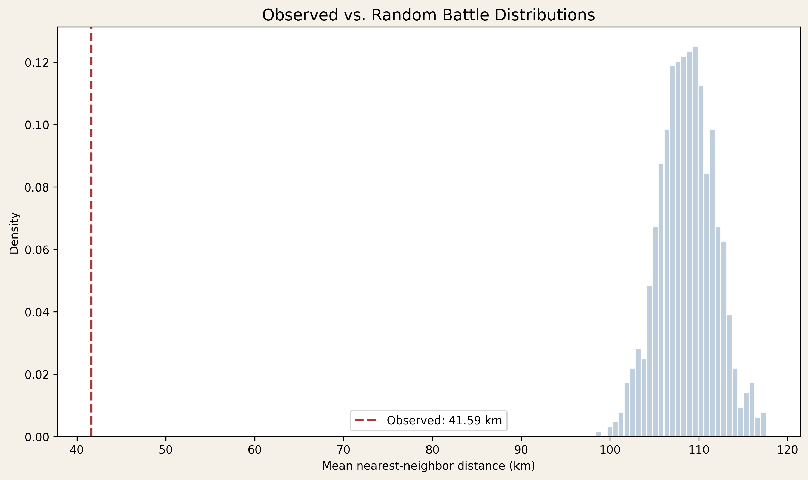{#fig-spatial-randomness-distribution}

## Settlement Based Models

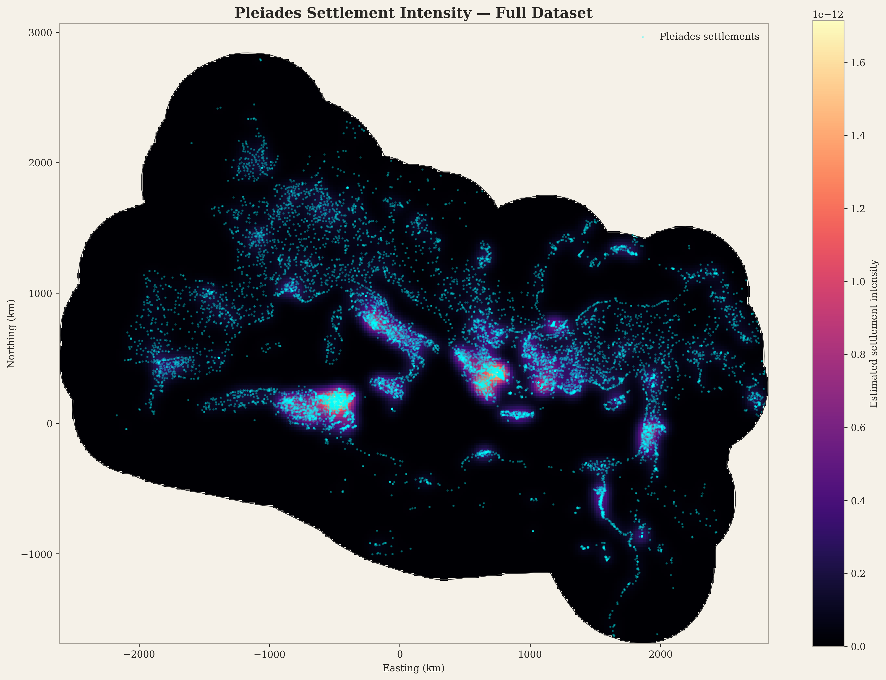{#fig-pleiades-settlement-intensity}

 Across the full historical dataset of battle-location records, the observed mean nearest-neighbor distance was 41.59 km, compared with an expected mean distance of 70.54 km under the settlement-based model. The observed-to-expected ratio was 0.590, indicating that the observed mean distance was approximately 41.0% lower than expected based on settlement geography an improvement over the spatial randomness model, but spatial clustering of battle locations persisted even after accounting for the distribution of known settlements.

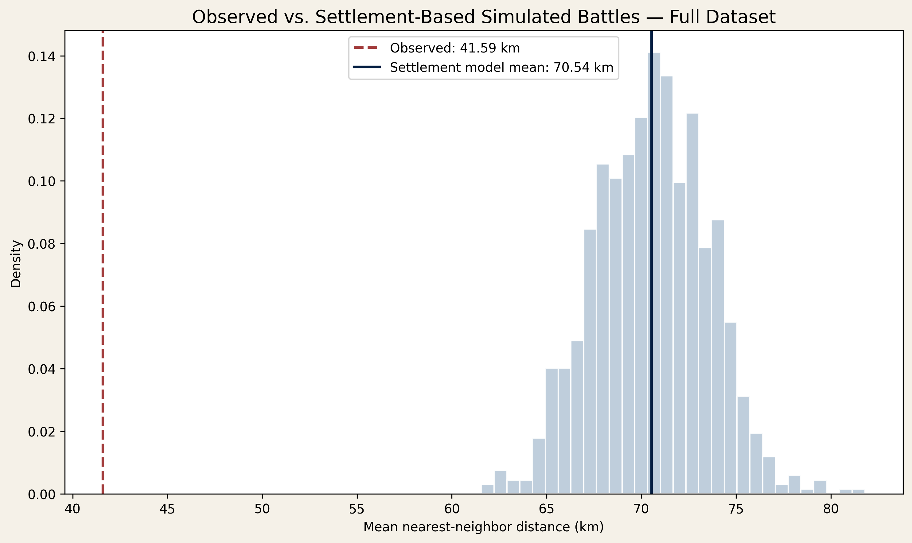{#fig-settlement-comparison}

### Border Distance Investigation

The border-distance investigation evaluated whether battle locations were closer to historical Roman territorial boundaries than expected based on the geographic distribution of known settlements. Across the 342 battle-location records, the observed mean distance to the nearest border was 139.63 km, compared with an expected mean distance of 288.93 km under the settlement intensity model. The observed-to-expected ratio was 0.483, indicating that battles occurred approximately 51.7% closer to territorial boundaries than expected based on settlement geography. None of the 999 simulations produced a mean distance as small as the observed value, suggesting that the relationship between battle locations and Roman territorial boundaries warranted further investigation beyond the influence of settlement distribution alone.

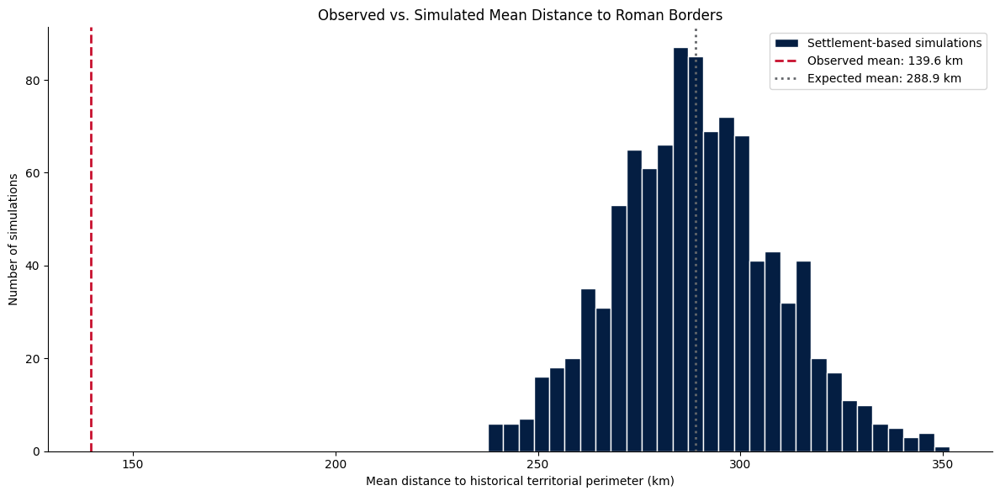{#fig-border-distance-distribution}

## Border Based Model

The simulated expected mean distance increased as the distance-decay parameter became broader. Under the 25 km decay model, the expected mean distance was 21.31 km, compared with 38.17 km under the 50 km model and 70.24 km under the 100 km model. Under the 200 km model, the expected mean distance increased to 135.88 km, producing the closest correspondence with the observed value. The observed-to-expected ratio declined from 6.554 under the 25 km model to 1.028 under the 200 km model.

@fig-border-simulations compares the observed mean border distance with the simulated distributions under each decay parameter. The observed statistic exceeded the 97.5th percentile of the simulations under the 25 km, 50 km, and 100 km models. Under the 200 km model, it fell within the central 95% simulation interval of 120.15 km to 153.16 km. This indicates that the broader 200 km decay assumption generated a distribution most consistent with the observed average distance from battles to territorial boundaries.

In contrast to the settlement-based model, which found that battle locations were more spatially clustered than expected given settlement geography, the border model suggests that a relatively broad distance-decay assumption is needed to reproduce the observed average proximity to territorial boundaries. 

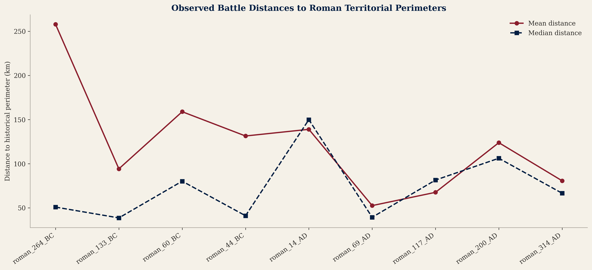{#fig-border-periods}

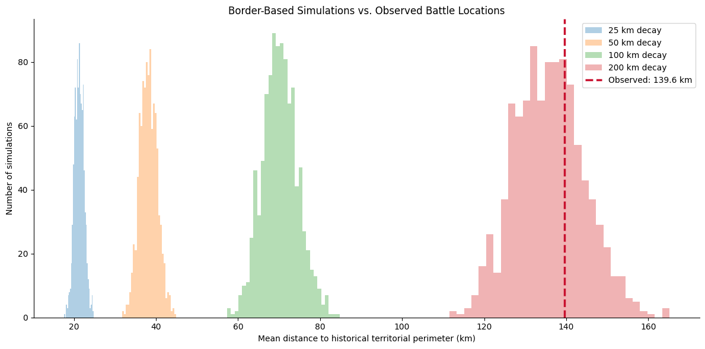{#fig-border-simulations}

### Civil versus External Conflict

The pooled results show a substantial difference between the two conflict classifications. Across the 83 civil-conflict records, the weighted observed mean distance to the nearest territorial boundary was 61.17 km. For the 259 external-conflict records, the corresponding distance was 164.78 km. Thus, external battles occurred, on average, approximately 2.7 times farther from territorial boundaries than civil conflicts.

The observed-to-expected ratios also differed between classifications. For civil conflicts, the ratio declined from 2.85 under the 25 km decay model to 0.56 under the 200 km model. Under the 100 km model, the ratio was 0.95, indicating that the observed mean distance was relatively close to the simulated expectation. In contrast, external battles had ratios above 1.0 under all four decay assumptions, ranging from 7.71 under the 25 km model to 1.14 under the 200 km model. This indicates that external battles were consistently farther from territorial boundaries than the border-weighted simulations predicted.

For all 342 battle-location records combined, the 200 km decay model produced the closest correspondence between observed and expected mean distances, with a ratio of 1.03. However, the classification-specific results suggest that this overall correspondence masks differences between external and civil conflicts. The 100 km and 200 km models produced expected distances relatively close to those observed for civil conflicts, while external battles remained farther from territorial boundaries than expected under each model.

These results suggest that the spatial relationship between Roman territorial boundaries and battle locations differed according to conflict classification. Civil conflicts were generally located closer to territorial boundaries, whereas external battles were more distant. This comparison is descriptive and does not establish that the differences are statistically significant; the period-level simulation distributions provide additional context for examining how these relationships varied over time.

| Classification | Battle locations | Observed mean (km) | 25 km ratio | 50 km ratio | 100 km ratio | 200 km ratio |
|---|---:|---:|---:|---:|---:|---:|
| All Battles | 342 | 139.63 | 6.56 | 3.67 | 1.98 | 1.03 |
| Civil Conflict | 83 | 61.17 | 2.85 | 1.65 | 0.95 | 0.56 |
| External | 259 | 164.78 | 7.71 | 4.30 | 2.27 | 1.14 |

## Settlement Attributes

### Battle Proximity to Specialized Settlement Features

To examine whether battle locations were unusually close to particular types of settlement infrastructure, four feature categories were evaluated: ports, temples, forts, and entertainment facilities (amphitheatres and theatres). The analysis included 99 port locations, 54 temple locations, 50 fort locations, and 89 entertainment locations. Results were evaluated separately for civil conflicts and external battles.

@fig-infrastructure-map shows the observed battle locations alongside the specialized settlement infrastructure used in the analysis.

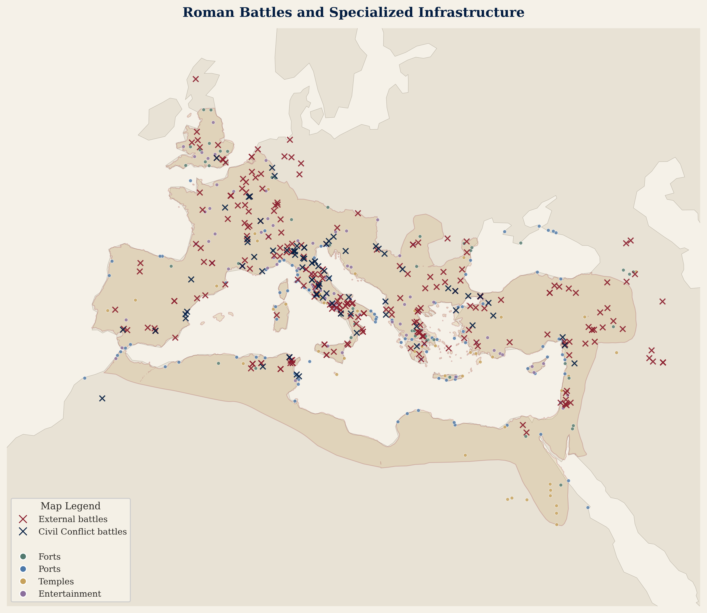{#fig-infrastructure-map}

#### Civil Conflicts

Civil conflicts exhibited the strongest proximity to entertainment facilities. The observed mean distance to the nearest entertainment location was 95.90 km, compared with a simulated expected distance of 229.26 km. The observed-to-expected ratio was 0.42, with a lower-tail Monte Carlo p-value of 0.001. The observed distance was substantially below the simulated distribution, indicating that civil conflicts were unusually close to entertainment facilities relative to the broader settlement geography.

Civil conflicts were also closer to ports than expected. The observed mean distance was 134.03 km, compared with an expected distance of 183.53 km. This produced an observed-to-expected ratio of 0.73 and a p-value of 0.004, providing evidence of unusually close proximity to port locations.

The results for temples and forts did not show comparable evidence of unusually close proximity. The observed mean distance to temples was 204.06 km, compared with an expected distance of 217.65 km (ratio = 0.94, p = 0.229). For forts, the observed mean distance was slightly greater than expected, at 246.42 km compared with 240.74 km (ratio = 1.02, p = 0.634).

Overall, the civil-conflict results indicate that battles were particularly close to entertainment facilities and ports, while the results for temples and forts did not indicate unusually close proximity.

#### External Battles

External battles also exhibited unusually close proximity to entertainment facilities. Their observed mean distance was 182.87 km, compared with an expected distance of 229.57 km. The observed-to-expected ratio was 0.80, with a lower-tail p-value of 0.002.

A similar pattern appeared for forts. External battles had an observed mean distance of 210.15 km, compared with an expected distance of 241.12 km (ratio = 0.87, p = 0.005). This indicates that external battles were closer to forts than expected under the settlement-based simulation.

The temple results were less conclusive. The observed mean distance was 200.74 km, compared with an expected distance of 217.03 km, producing a ratio of 0.92 and a p-value of 0.051. Although the observed distance was shorter than expected, the result was just above the conventional 0.05 threshold.

Ports showed a different pattern. External battles were farther from ports than expected, with an observed mean distance of 218.88 km compared with an expected distance of 184.55 km. The observed-to-expected ratio was 1.19, and the lower-tail p-value was 1.000. Thus, the simulations provide no evidence that external battles were unusually close to ports.

#### Comparison Between Conflict Classifications

The results reveal differences in the spatial relationships between battle classifications and specialized settlement features. Entertainment facilities were the only category for which both civil conflicts and external battles showed evidence of unusually close proximity relative to the settlement-based simulations. However, the difference between observed and expected distances was substantially larger for civil conflicts.

Ports and forts displayed contrasting patterns across the two classifications. Civil conflicts were significantly closer to ports than expected, whereas external battles were farther away. Conversely, external battles were significantly closer to forts than expected, while civil conflicts showed no evidence of unusually close proximity to them.

Temples produced the least conclusive results. Neither classification showed evidence of unusually close proximity at the 0.05 significance threshold, although the external-battle result approached that threshold.

@tbl-feature-proximity summarizes the observed and simulated distances for all eight comparisons. 

| Feature category | Classification | Battle locations | Feature locations | Observed mean (km) | Expected mean (km) | Ratio | Lower-tail p-value |
|:---|:---|---:|---:|---:|---:|---:|---:|
| Entertainment | Civil Conflict | 83 | 89 | 95.90 | 229.26 | 0.42 | 0.001 |
| Ports | Civil Conflict | 83 | 99 | 134.03 | 183.53 | 0.73 | 0.004 |
| Temples | Civil Conflict | 83 | 54 | 204.06 | 217.65 | 0.94 | 0.229 |
| Forts | Civil Conflict | 83 | 50 | 246.42 | 240.74 | 1.02 | 0.634 |
| Entertainment | External | 259 | 89 | 182.87 | 229.57 | 0.80 | 0.002 |
| Forts | External | 259 | 50 | 210.15 | 241.12 | 0.87 | 0.005 |
| Temples | External | 259 | 54 | 200.74 | 217.03 | 0.92 | 0.051 |
| Ports | External | 259 | 99 | 218.88 | 184.55 | 1.19 | 1.000 |

: Observed and simulated mean distances between battle locations and specialized settlement features. {#tbl-feature-proximity}

These findings suggest that the relationship between Roman battles and settlement infrastructure varied by conflict classification and feature type. Civil conflicts were particularly close to entertainment facilities and ports, while external battles were closer than expected to entertainment facilities and forts. These patterns are consistent with different spatial relationships between the two types of conflict and the surrounding settlement landscape, although they do not establish that these features directly influenced where battles occurred.

The results should also be interpreted in light of the eight comparisons conducted. The p-values are exploratory and have not been adjusted for multiple testing. In addition, the simulations provide a conditional comparison against the broader settlement distribution rather than a uniformly random distribution of locations across the study area.

## Military and Civic Infrastructure

### Unique Battle Locations

The observed mean nearest-neighbor distances were 50.25 km for external battles, 89.65 km for civil conflicts, and 43.02 km for all battles combined. These results indicate that external battles were more spatially concentrated than civil conflicts, while the combined dataset exhibited the shortest mean nearest-neighbor distance.

### General Settlement Baseline

As established in the preceding settlement-based analysis, battle locations remained more spatially clustered than expected under a model accounting for the geographic distribution of known settlements. 

The expected mean nearest-neighbor distances were 82.94 km for external battles, 153.46 km for civil conflicts, and 71.87 km for all battles combined. The observed-to-expected ratios were 0.606, 0.584, and 0.599, respectively, with two-sided Monte Carlo p-values of 0.002 for all three comparisons. These settlement-based results provide the baseline against which the infrastructure-weighted simulations are compared below.

### Comparison of Settlement and Infrastructure Models

The infrastructure-weighted simulations produced different results depending on the decay distance and battle classification. In general, increasing the decay distance produced less spatially concentrated simulated patterns, as reflected by progressively larger expected mean nearest-neighbor distances.

For external battles, the 25 km fort-based model produced an expected mean nearest-neighbor distance of 39.14 km, compared with the observed distance of 50.25 km. The observed-to-expected ratio was 1.284, and the two-sided Monte Carlo p-value was 0.002. In this case, the observed battles were less tightly clustered than the simulated locations concentrated around forts.

As the decay distance increased, the expected nearest-neighbor distance also increased. Under the 50 km model, the expected distance was 62.06 km (ratio = 0.810, p = 0.002). The 100 km and 200 km models produced expected distances of 87.97 km and 108.65 km, respectively, with observed-to-expected ratios of 0.571 and 0.463. Both models produced p-values of 0.002. Thus, the broader fort-weighted distributions produced simulated battle patterns that were less tightly clustered than the observed external battles.

Civil conflicts displayed a different pattern. The 25 km entertainment-based model produced an expected mean nearest-neighbor distance of 111.21 km, compared with the observed distance of 89.65 km (ratio = 0.806, p = 0.020). The 50 km model produced an expected distance of 129.98 km (ratio = 0.690, p = 0.002). Under the 100 km and 200 km models, expected distances increased to 154.72 km and 186.27 km, respectively. Both models produced observed-to-expected ratios below 0.60 and p-values of 0.002. Across all four decay parameters, the simulated civil-conflict patterns were less tightly clustered than the observed distribution.

For all battles combined, the 25 km infrastructure model produced an expected mean nearest-neighbor distance of 45.23 km, relatively close to the observed distance of 43.02 km. Its observed-to-expected ratio was 0.951, and the two-sided p-value was 0.304. This was the only model comparison that did not indicate a statistically unusual difference between the observed and simulated clustering statistics at the conventional 0.05 threshold.

The broader infrastructure models produced progressively larger expected distances. At 50 km, the expected distance was 62.39 km (ratio = 0.690, p = 0.002). At 100 km and 200 km, expected distances increased to 80.89 km and 96.54 km, with ratios of 0.532 and 0.446, respectively. Both comparisons produced p-values of 0.002. For comparison, the general settlement model produced an expected distance of 71.87 km (ratio = 0.599, p = 0.002).

Overall, the results indicate that the relationship between infrastructure-weighted spatial distributions and observed battle clustering varied by classification. The 25 km fort-based model generated a more tightly clustered external-battle pattern than the observed distribution, while the broader fort-based models generated less tightly clustered patterns. Civil-conflict simulations consistently produced less clustered patterns than those observed, although the difference was smallest under the 25 km entertainment-based model.

The 25 km infrastructure model also produced the closest correspondence with the observed clustering of all battles combined. This result can be viewed through the lense of the classification-specific simulations: the combined model joins separately simulated external battles weighted toward forts and civil conflicts weighted toward entertainment facilities. It therefore represents a combination of two infrastructure-weighted distributions rather than a single probability surface.

@tbl-infrastructure-model summarizes the observed and simulated mean nearest-neighbor distances across the general settlement and infrastructure-weighted models.

| Model | Classification | Observed mean (km) | Expected mean (km) | Ratio | 2.5th percentile (km) | 97.5th percentile (km) | Two-sided p-value |
|:---|:---|---:|---:|---:|---:|---:|---:|
| Settlement | External | 50.25 | 82.94 | 0.61 | 75.14 | 90.61 | 0.002 |
| Infrastructure 25 km | External | 50.25 | 39.14 | 1.28 | 35.23 | 43.12 | 0.002 |
| Infrastructure 50 km | External | 50.25 | 62.06 | 0.81 | 56.49 | 68.17 | 0.002 |
| Infrastructure 100 km | External | 50.25 | 87.97 | 0.57 | 80.84 | 95.14 | 0.002 |
| Infrastructure 200 km | External | 50.25 | 108.65 | 0.46 | 100.43 | 116.86 | 0.002 |
| Settlement | Civil Conflict | 89.65 | 153.46 | 0.58 | 127.27 | 178.88 | 0.002 |
| Infrastructure 25 km | Civil Conflict | 89.65 | 111.21 | 0.81 | 93.36 | 129.79 | 0.020 |
| Infrastructure 50 km | Civil Conflict | 89.65 | 129.98 | 0.69 | 111.03 | 148.92 | 0.002 |
| Infrastructure 100 km | Civil Conflict | 89.65 | 154.72 | 0.58 | 133.54 | 175.50 | 0.002 |
| Infrastructure 200 km | Civil Conflict | 89.65 | 186.27 | 0.48 | 161.90 | 213.45 | 0.002 |
| Settlement | All Battles | 43.02 | 71.87 | 0.60 | 65.76 | 77.63 | 0.002 |
| Infrastructure 25 km | All Battles | 43.02 | 45.23 | 0.95 | 41.28 | 49.23 | 0.304 |
| Infrastructure 50 km | All Battles | 43.02 | 62.39 | 0.69 | 57.34 | 67.31 | 0.002 |
| Infrastructure 100 km | All Battles | 43.02 | 80.89 | 0.53 | 75.18 | 86.98 | 0.002 |
| Infrastructure 200 km | All Battles | 43.02 | 96.54 | 0.45 | 89.81 | 102.66 | 0.002 |

: Comparison of observed and simulated mean nearest-neighbor distances across settlement and infrastructure-weighted models. {#tbl-infrastructure-model}

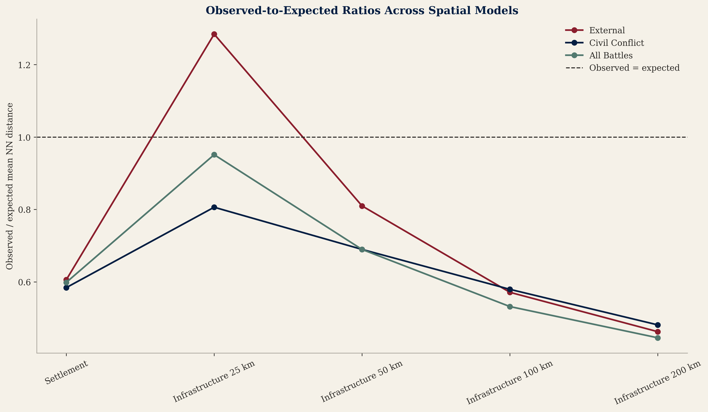{#fig-infrastructure-ratios}

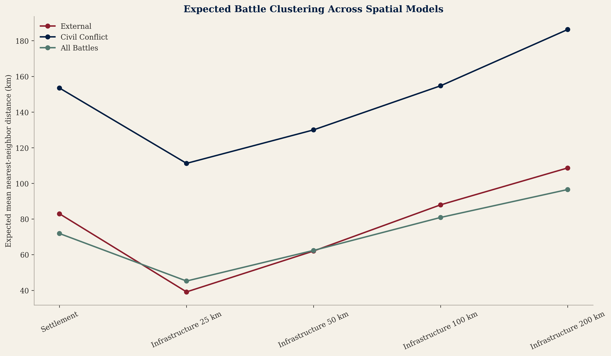{#fig-infrastructure-distances}

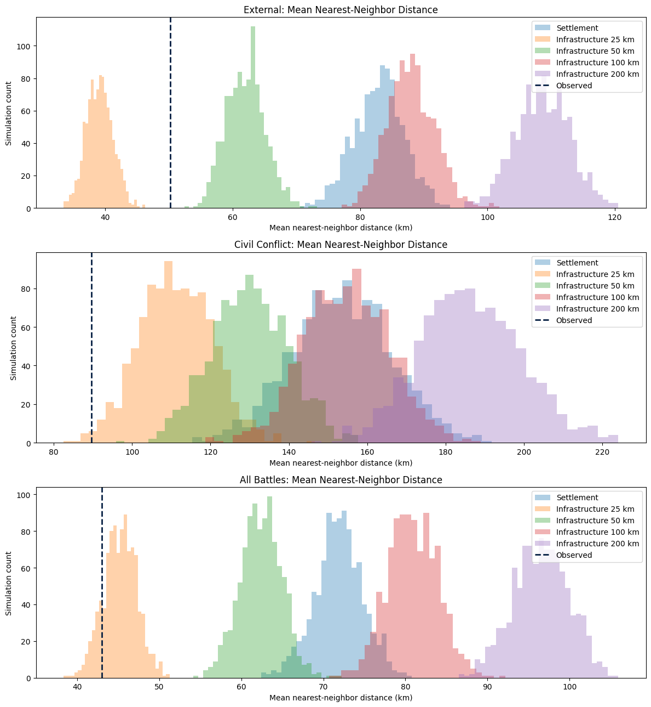{#fig-representative-infrastructure}

# Conclusion

This study examined the spatial geography of Roman warfare by evaluating the relationship between battle locations, settlement patterns, territorial boundaries, and specialized infrastructure. Using battle-location records across multiple historical periods, the analysis applied spatial statistical methods and Monte Carlo simulations to investigate whether the distribution of Roman battles could be explained by broader geographic patterns. The results indicate that Roman battles were not distributed randomly across the study area. Instead, their locations exhibited substantial spatial clustering, and this clustering persisted when the distribution of documented settlements was incorporated into the statistical models.

The settlement-based analysis demonstrated that the geography of known settlements provided a better explanation for the distribution of battles than spatial randomness alone. However, the model still fell short of reproducing the observed clustering. The expected mean nearest-neighbor distance decreased substantially when settlement geography was incorporated, but remained considerably higher than the observed distance. This suggests that settlement geography provides an important baseline for understanding the distribution of Roman battles, but does not fully account for the factors associated with their spatial concentration.

The territorial-boundary analysis identified another important spatial relationship. Battle locations were, on average, substantially closer to historical Roman territorial boundaries than expected under the settlement-conditioned model. However, the border-weighted simulations revealed that the strength of this relationship depended on the assumed distance-decay parameter. The broadest model, using a 200 km decay distance, produced the closest correspondence with the observed overall mean distance. This suggests that the geographic relationship between warfare and Roman territorial boundaries was not necessarily limited to engagements immediately adjacent to the frontier. Rather, the results are consistent with a broader zone of military activity surrounding the territorial limits of Roman control.

The classification-based results further demonstrate that external and civil conflicts exhibited different spatial relationships with Roman territorial boundaries. External battles remained farther from the boundaries than expected under each of the four border-weighted models, while the civil-conflict results were more closely reproduced by the broader decay assumptions. This finding differed from the initial expectation that external conflicts would exhibit the strongest relationship with territorial boundaries. Instead, the results suggest that combining all Roman battles into a single spatial distribution can obscure meaningful variation in the geography of different types of conflict.

The infrastructure analysis provides additional evidence of these differences. Civil conflicts exhibited particularly strong proximity to entertainment facilities and ports relative to the broader settlement geography. External battles, in contrast, were unusually close to forts and entertainment facilities, while showing no evidence of unusually close proximity to ports. The classification-based nearest-neighbor simulations also demonstrated that the relationship between infrastructure and battle clustering varied according to the assumed distance-decay parameter. The 25 km infrastructure model produced the closest correspondence with the observed clustering of all battles combined, although this aggregate result concealed differences between the two classifications. External battles were less tightly clustered than the fort-weighted simulations under the narrowest decay assumption, while civil conflicts remained more tightly clustered than their entertainment-weighted simulations.

Taken together, the findings suggest that the spatial geography of Roman warfare is more complicated than any single model in this study can explain. The analyses provide evidence against spatial randomness and demonstrate that settlement geography improves upon a uniform random baseline. However, settlement geography alone does not reproduce the observed concentration of battles. Territorial boundaries and specialized infrastructure offer additional ways of characterizing this distribution, but their explanatory value varies across historical periods, conflict classifications, and model assumptions.

Rather than identifying one definitive geographic explanation for where Roman battles occurred, this study highlights the limitations of treating military activity as the product of a single spatial relationship. The results suggest that Roman warfare was associated with several overlapping geographic structures, but that the importance of these structures differed depending on the type and historical context of the conflict. This leaves open considerable opportunities for further research into the geographic, political, and strategic factors underlying the distribution of Roman military engagements.

## Limitations and Future Research

### Limitations

Several limitations should be considered when interpreting these findings. First, the battle dataset is dependent on the availability and geographic precision of historical records and their representation in Wikidata. The resulting sample is therefore not a complete inventory of all Roman military engagements. A cursory look at the battle mappings of the different historical time period shows centuries where there appear to be only a few battles recorded most likely due to limited sources as opposed to those being true times of peace.  

This leads to next limitation, the historical boundary reconstructions provide snapshots of Roman territorial extent rather than continuous representations of political control. This is particularly important for the time period of the Roman republic when the borders of the empire rapidly changed.  This may have meaningfully impacted the border analysis done in this research.
 

### Future Research

The amount of future research opportunities are as exciting as they are plenty.  The most obvious continuation would be to incorporate geographical features such as rivers, mountains, and more into this research.  Any traditional study of military history will include a lot many mentions of river crossings or mountain passes where decisive battles take place, so pulling in that information would bring this quantitative research in closer proximity to the shoulders of giants studying Roman history.

Expanding the temporal range of the study would also bring in existing new possibilities.  This study of battles ends slightly after the fall of the Western Roman Empire, but futher study could be done to include the campaigns of Belisarius where the Eastern Roman Empire retook North Africa and Italy all the way until the fall of Constantinople to Mehmed II.

The most exciting potential area of expansion, would be to pull in details of the battles or wars themselves through additional data on WikiData and Wikipedia.  Using linked articles of the battles to pull in additional context either through network analysis or NLP on the articles itself.  This would allow for a finer grain distinction than the civil versus external conflict in this study and would allow for groupings of conflicts based on numerous factors. 

# References